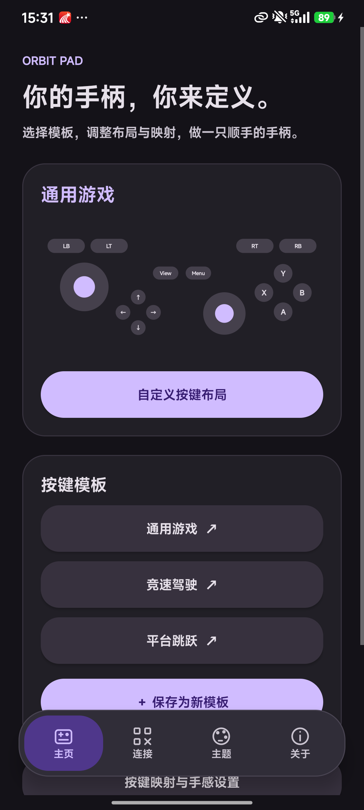

# ORBIT PAD · 手机无线手柄

把手机变成 Windows 手柄，支持扫码、USB 数据线、蓝牙直连与局域网手动配对。

## 最新版本：0.5.0 XInput

- [Android APK](https://github.com/OYLT/Orbit-Pad/releases/download/v0.5.0-xinput/OrbitPad-Android-v0.5.0.apk)
- [Windows x64 接收端](https://github.com/OYLT/Orbit-Pad/releases/download/v0.5.0-xinput/OrbitPad-Receiver-Windows-x64-v0.5.0-xinput.zip)
- [版本说明、测试报告与 SHA-256 校验](https://github.com/OYLT/Orbit-Pad/releases/tag/v0.5.0-xinput)


当前版本已改用 ViGEmBus 创建 Xbox 360 虚拟手柄，双摇杆和 LT / RT 连续输出模拟量。自定义映射目标为手柄按键和摇杆轴，旧键盘配置升级时恢复原生对应关系并保留布局与手感设置。LT / RT 默认按住为全按，按住后向下滑动可减小力度。

本地 Windows 包：`releases/OrbitPad-Receiver-Windows-x64-v0.5.0-xinput.zip`。首次完整解压后运行包内 `安装手柄驱动.cmd`，完成 ViGEmBus 安装后启动接收端；已安装驱动可直接启动。Android 本地构建为 `releases/OrbitPad-Android-v0.5.0.apk`。本次增强版以 v0.5.0-xinput 发布，应用内版本保持 0.5.0，沿用原发布签名。历史 v0.5.0 下载保留为键盘版。

详细依赖、测试与安装说明见 [原生手柄说明](docs/NATIVE-GAMEPAD.md)。

## 已发布历史版本：0.5.0

- [Android APK](https://github.com/OYLT/Orbit-Pad/releases/download/v0.5.0/OrbitPad-Android-v0.5.0.apk)
- [Windows x64 接收端](https://github.com/OYLT/Orbit-Pad/releases/download/v0.5.0/OrbitPad-Receiver-Windows-x64-v0.5.0.zip)
- [版本说明与 SHA-256 校验文件](https://github.com/OYLT/Orbit-Pad/releases/tag/v0.5.0)

- 悬浮 Dock：主页、连接、主题、设置；设置页内含关于与 Liquid Glass 折射调节，主题页按计划保留空白。
- 主页管理手柄模板，支持拖动控件、单独调整大小和显隐、修改映射，并保存、加载和删除自定义模板。
- 连接页默认扫码，提供相机和图片识别，也可选择 USB、蓝牙或手动配对。
- USB 使用数据线上的 ADB 通道；蓝牙使用配对后的加密 RFCOMM 通道，均由新版电脑接收端提供，不使用网络共享。
- 关于页提供版本、系统支持、连接方式、项目地址及组件信息。

Android 8.0+，包含 ARM64 和 x86_64 Rust 原生库，沿用发布签名。局域网连接仍兼容 0.3.0 接收端；USB 和蓝牙直连须使用 0.5.0 Windows 接收端。详见 [0.5.0 使用说明](docs/V0.5.0.md) 和 [Rust Android 说明](docs/ANDROID-RUST.md)。历史版 0.4.0 的 62 项真机记录保留在 [历史真机报告](docs/REDMI-RUST-TEST-REPORT.md)。

## 已发布下载 v0.3.0

- [Android APK](https://github.com/OYLT/Orbit-Pad/releases/download/v0.3.0/OrbitPad-Android-v0.3.0.apk)
- [Windows x64 接收端](https://github.com/OYLT/Orbit-Pad/releases/download/v0.3.0/OrbitPad-Receiver-Windows-x64-v0.3.0.zip)
- [版本说明与 SHA-256 校验文件](https://github.com/OYLT/Orbit-Pad/releases/tag/v0.3.0)

新版在 Redmi K40 Pro+ / Android 16 上通过 97 项真机步骤，包含真实 USB 与蓝牙直连，见 [0.5.0 真机报告](docs/REDMI-V0.5.0-TEST-REPORT.md)。



## Android APK 与 Windows 软件

当前本地构建文件位于 `releases/`：

- `OrbitPad-Android-v0.5.0.apk`：Android 8.0+，原生 Dock 四页、模板编辑、扫码及直连，Rust 控制核心。
- `OrbitPad-Receiver-Windows-x64-v0.5.0-xinput.zip`：Windows 10 / 11 x64 便携版，带 USB / 蓝牙服务。完整解压后运行 `OrbitPadReceiver.exe`，自带 Node.js 和官方 Android platform-tools。

电脑软件启动后，在手机连接页扫码即可配对，手动输入地址和配对码也是可选方式。电脑软件最小化后进入系统托盘；关闭窗口停止服务并释放输入。依赖 Windows 自带的 .NET Framework 4.7.2+ 和一次安装的 ViGEmBus 驱动。

完整操作说明见 `docs/README-START.txt`。Windows 程序尚未商业代码签名。APK 已由本项目本地发布密钥签名并通过签名校验。历史版 0.3.0 在 Redmi K40 Pro+（Android 16）通过 45 个真机步骤；此前 0.2.1 已验证手机 A 键实际在 Windows 测试窗口产生空格按下与松开；具体游戏兼容性尚未验证。历史记录见 `docs/REDMI-TEST-REPORT.md`。

## 开始使用

1. 电脑安装 Node.js 22 或以上版本。
2. 在此文件夹运行 `npm install`、`npm run setup:gamepad`，运行 **安装手柄驱动.cmd** 完成驱动安装，再双击 **启动手柄.cmd** 或运行 `npm start`。
3. 电脑打开 http://localhost:3210 ，选择手机可访问的局域网地址。多个地址通常来自 Wi-Fi、网线、VPN 或虚拟网卡，请选择与手机同网段的地址。
4. 手机与电脑连接同一个 Wi-Fi，用相机扫描电脑上的二维码；也可在手机浏览器输入电脑显示的局域网地址，再输入六位配对码。
5. 手机点击 **开始控制**，横屏使用。将电脑前台切换到游戏窗口。

`npm run preview` 启动不产生系统手柄输入的预览模式。电脑页面里的交互预览始终不会输出系统手柄输入。

## 界面设计

手机连接页、横屏手柄、按键映射、手感设置、连接指南、Windows 接收端及浏览器控制台统一采用 Material Design 3 深色视觉语言。使用紫色主色、色调表面、圆角卡片、填充按钮、描边输入框、分段控件和 Material 滑块；全屏右上角可直接打开设置。

Android 使用原生平台控件和 Canvas 绘制手柄，浏览器手柄使用 HTML/CSS，Windows 使用 WinForms 自绘控件，三端共享配色和形状规范。

## 已实现

- 手机横屏全屏手柄、双摇杆、方向键、ABXY、肩键、扳机、View / Menu。
- Pointer Events 多点触控，支持摇杆与多个按键同时操作。
- 六位配对码与二维码；WebSocket 局域网传输，显示往返延迟（RTT）。
- 通用、竞速、平台跳跃预设；22 项原生手柄控件映射、本机配置保存、摇杆死区、显示比例与可用设备上的振动反馈。
- ViGEmBus 原生 Xbox 360 / XInput 虚拟手柄；接收端自带客户端 DLL，驱动首次安装后使用。
- 电脑接收暂停、恢复、设备断开、配对撤销、输入状态监测。
- 切后台、失去焦点、连接关闭与约 2 秒通信超时自动释放按键；原生接收进程也有独立看门狗。
- 一台电脑同时接受一台手机控制。

## 默认映射

| 控件 | Windows 手柄输出 |
| --- | --- |
| 左 / 右摇杆 | 左 / 右模拟摇杆，16 位轴值 |
| 方向键 | 原生十字方向键 |
| A / B / X / Y | Xbox ABXY |
| LB / RB | 左 / 右肩键 |
| LT / RT | 左 / 右扳机，0–255 |
| View / Menu | Back / Start |

## 当前边界

提供移动网页、Android APK 和 Windows 桌面接收端，尚无 iOS 安装包。Android 0.5.0 的 Dock、连接、手柄和设置均为本地原生界面，Rust 直接连接电脑接收端；网页仍可通过局域网 HTTP 地址直接使用。不同浏览器可能限制系统全屏、常亮和振动，Android App 提供原生横屏与常亮。控制电脑时必须保持所选的局域网、USB 或蓝牙通道。

**输出为 Xbox 360 / XInput 虚拟手柄。** 游戏须支持手柄操作。双摇杆保留模拟量并使用径向死区，扳机支持 0–255 力度；旧手机客户端的数字扳机兼容为 0 / 255。Wi-Fi、USB 和蓝牙均使用同一原生输出链路。

ViGEmBus 上游已停止维护，本项目固定使用官方 1.22.0 驱动及 1.21.256 客户端包，并校验 SHA-256；详情见 [上游说明](https://docs.nefarius.at/projects/ViGEm/End-of-Life/)。驱动安装需按 Windows 提示授权。

## 网络与配对

- 接收端监听 `0.0.0.0:3210`。仅在可信的家庭或专用局域网使用，请勿将此端口转发到公网。
- 若 Windows 提示防火墙权限，允许 Node.js 在你使用的专用网络通信。项目不会自动修改防火墙。
- 手机无法访问时，检查是否同一 Wi-Fi、VPN 是否改变路由、路由器是否开启 AP / 客户端隔离。
- 管理接口和二维码仅能从电脑的 localhost 访问；其他设备不能读取配对码。
- 配对 token 有效期为 12 小时，本机保存；重启接收端或点击「重置配对」后失效。
- HTTP / WebSocket 通信未加密，配对码与 token 的保护范围限于可信局域网。

## 开发与验证

本地工作区增加了 Dock Liquid Glass 磨砂透镜、长按果冻回弹、拖动惯性形变与阻尼偏移，支持 HyperOS 3 手势区沉浸及设置页的四档折射强度。技术路线、质量开关和真机检查命令见 [实现说明](docs/LIQUID-GLASS.md)。

```powershell
npm install
npm test
npm run test:android
npm run preview
```

测试覆盖真实 HTTP / WebSocket 配对、错误输入、限流、配置切换、并发设备、暂停与恢复、撤销 token、断线 / 超时释放，以及 Windows XInput 实际读回、原生看门狗归零与设备移除。HTTP / WebSocket 测试使用内存手柄报告；Windows 集成测试创建独立虚拟手柄，并从 XInput 读回模拟值。未安装驱动时该硬件测试明确跳过。

设置其他端口：`$env:PORT=3211; npm start`。此时手动打开对应端口；双击启动器默认使用 3210。

文件结构：`public/` 手机和电脑界面；`server/` 配对与通信；`native/GamepadBridge.cs` Windows 原生手柄桥接；`test/` 自动化测试。

## 构建安装包

```powershell
npm run build:android
npm run build:windows
```

Android 构建需要 Windows x64、JDK 17+ 和 Python 3。可以用 `JAVA_HOME` 指定 JDK，脚本也会识别本机构建时发现的现有 JDK。首次构建从官方源下载 API 35 平台、Build Tools 35.0.0、NDK r28c 和 Rust 1.90.0，并校验下载哈希；工具仅放在项目 `.build-tools/`，不修改系统 PATH。使用 `cargo → aapt2 → javac → D8 → zipalign → apksigner` 构建，不依赖 Gradle 或 Android Studio。首次构建完成工具安装后可运行 `npm run test:android` 检查 Rust 核心。

Android 发布签名保存在 `.build-tools/orbitpad-release.jks` 和 `.build-tools/android-signing.json`，仅供本机构建、未打入发布包。请妥善备份，后续升级同一 App 需要使用同一密钥。`.build-tools/` 已排除于版本控制。

Windows 构建使用系统 .NET Framework C# 编译器，将本机 Node.js 运行环境、生产依赖和接收端资源打入便携包；脚本先准备原生手柄组件和驱动安装包，运行原生模式自检后生成 ZIP。无驱动的构建机可使用 `powershell -File scripts/build-windows.ps1 -PreviewSelfTest` 仅运行预览自检。运行时 Node.js 进程受桌面进程监护，桌面程序异常退出后也会停止接收。

`android/` 为手机原生项目，`desktop/` 为 Windows 窗口源码，`scripts/` 为可重复运行的构建脚本。发布目录包含 APK 签名报告、Windows 自检报告和 SHA-256 校验文件。
