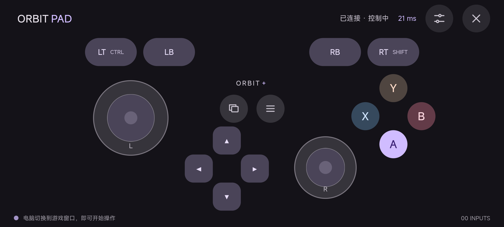

# ORBIT PAD · 手机无线手柄

把手机变成 Wi-Fi 手柄，通过浏览器控制同一局域网中的 Windows 电脑。

## 下载 v0.3.0

- [Android APK](https://github.com/OYLT/Orbit-Pad/releases/download/v0.3.0/OrbitPad-Android-v0.3.0.apk)
- [Windows x64 接收端](https://github.com/OYLT/Orbit-Pad/releases/download/v0.3.0/OrbitPad-Receiver-Windows-x64-v0.3.0.zip)
- [版本说明与 SHA-256 校验文件](https://github.com/OYLT/Orbit-Pad/releases/tag/v0.3.0)



## Android APK 与 Windows 软件

已提供 0.3.0 构建，文件位于 `releases/`：

- `OrbitPad-Android-v0.3.0.apk`：Android 8.0+，带原生连接页、横屏、常亮和后台释放。连接后从电脑接收端载入共享手柄界面。
- `OrbitPad-Receiver-Windows-x64-v0.3.0.zip`：Windows 10 / 11 x64 便携版。完整解压后运行 `OrbitPadReceiver.exe`，包含 Node.js 运行环境，无需另行安装 Node.js。

电脑软件启动后，在 Android App 中填写窗口显示的 IP:端口和六位配对码。二维码用于浏览器版。最小化电脑软件后会进入系统托盘；关闭窗口将停止接收。依赖 Windows 自带的 .NET Framework 4.7.2+ 和 Windows PowerShell。

完整操作说明见 `docs/README-START.txt`。Windows 程序尚未商业代码签名。APK 已由本项目本地发布密钥签名并通过签名校验。已在 Redmi K40 Pro+（Android 16）通过 45 个真机步骤；此前 0.2.1 已验证手机 A 键实际在 Windows 测试窗口产生空格按下与松开；具体游戏兼容性尚未验证。详见 `docs/REDMI-TEST-REPORT.md`。

## 开始使用

1. 电脑安装 Node.js 22 或以上版本。
2. 在此文件夹运行 `npm install`，然后双击 **启动手柄.cmd**；也可以运行 `npm start`。
3. 电脑打开 http://localhost:3210 ，选择手机可访问的局域网地址。多个地址通常来自 Wi-Fi、网线、VPN 或虚拟网卡，请选择与手机同网段的地址。
4. 手机与电脑连接同一个 Wi-Fi，用相机扫描电脑上的二维码；也可在手机浏览器输入电脑显示的局域网地址，再输入六位配对码。
5. 手机点击 **开始控制**，横屏使用。将电脑前台切换到游戏窗口。

`npm run preview` 启动不产生系统键盘输入的预览模式。电脑页面里的交互预览始终不会发送系统按键。

## 界面设计

手机连接页、横屏手柄、按键映射、手感设置、连接指南、Windows 接收端及浏览器控制台统一采用 Material Design 3 深色视觉语言。使用紫色主色、色调表面、圆角卡片、填充按钮、描边输入框、分段控件和 Material 滑块；全屏右上角可直接打开设置。

Android 使用原生平台控件配合主题绘制，手柄使用 HTML/CSS，Windows 使用 WinForms 自绘控件，三端共享配色和形状规范。

## 已实现

- 手机横屏全屏手柄、双摇杆、方向键、ABXY、肩键、扳机、View / Menu。
- Pointer Events 多点触控，支持摇杆与多个按键同时操作。
- 六位配对码与二维码；WebSocket 局域网传输，显示往返延迟（RTT）。
- 通用、竞速、平台跳跃预设；22 项自定义按键映射、本机配置保存、摇杆死区、显示比例与可用设备上的振动反馈。
- Windows `SendInput` 扫描码键盘输入桥接；无需第三方虚拟手柄驱动。
- 电脑接收暂停、恢复、设备断开、配对撤销、输入状态监测。
- 切后台、失去焦点、连接关闭与约 2 秒通信超时自动释放按键；原生接收进程也有独立看门狗。
- 一台电脑同时接受一台手机控制。

## 默认映射

| 控件 | 电脑按键 |
| --- | --- |
| 左摇杆 | W / A / S / D |
| 右摇杆与方向键 | 方向键 |
| A / B / X / Y | 空格 / E / R / F |
| LB / RB | Q / C |
| LT / RT | Ctrl / Shift |
| View / Menu | Tab / Esc |

## 当前边界

提供移动网页、Android APK 和 Windows 桌面接收端，尚无 iOS 安装包。Android App 使用原生连接页和受限 WebView，手柄界面由电脑接收端在局域网提供；网页仍可通过局域网 HTTP 地址直接使用。不同浏览器可能限制系统全屏、常亮和振动，Android App 提供原生横屏与常亮。没有离线控制功能，通信必须保持连接。

**输出是键盘输入，并非 Xbox / XInput / DirectInput 虚拟手柄。** 摇杆与扳机目前转换为数字按键，没有模拟量输出。支持键盘操作且接受模拟输入的游戏才能使用；某些游戏、反作弊系统或独占输入模式可能不接受这种方式。没有针对具体游戏做兼容性验证。

若游戏以管理员身份运行，Windows 的输入权限隔离可能阻止普通权限接收端输入。必要时以相同权限运行接收端。API 行为参考 [Microsoft SendInput 文档](https://learn.microsoft.com/windows/win32/api/winuser/nf-winuser-sendinput)。

## 网络与配对

- 接收端监听 `0.0.0.0:3210`。仅在可信的家庭或专用局域网使用，请勿将此端口转发到公网。
- 若 Windows 提示防火墙权限，允许 Node.js 在你使用的专用网络通信。项目不会自动修改防火墙。
- 手机无法访问时，检查是否同一 Wi-Fi、VPN 是否改变路由、路由器是否开启 AP / 客户端隔离。
- 管理接口和二维码仅能从电脑的 localhost 访问；其他设备不能读取配对码。
- 配对 token 有效期为 12 小时，本机保存；重启接收端或点击「重置配对」后失效。
- HTTP / WebSocket 通信未加密，配对码与 token 的保护范围限于可信局域网。

## 开发与验证

```powershell
npm install
npm test
npm run preview
```

测试覆盖真实 HTTP / WebSocket 配对、错误输入、限流、配置切换、并发设备、暂停与恢复、撤销 token、断线 / 超时释放，以及 Windows 原生进程编译与无按键启动。测试使用内存输入桥接，不向其他应用发送测试按键。

设置其他端口：`$env:PORT=3211; npm start`。此时手动打开对应端口；双击启动器默认使用 3210。

文件结构：`public/` 手机和电脑界面；`server/` 配对与通信；`native/keyboard.ps1` Windows 输入桥接；`test/` 自动化测试。

## 构建安装包

```powershell
npm run build:android
npm run build:windows
```

Android 构建需要 JDK 17+ 和 Python 3。可以用 `JAVA_HOME` 指定 JDK，脚本也会识别本机构建时发现的现有 JDK。首次构建从 Google 官方 SDK 仓库下载 API 35 平台与 Build Tools 35.0.0，并校验仓库提供的哈希；所有工具仅放在项目 `.build-tools/`。使用 `aapt2 → javac → D8 → zipalign → apksigner` 构建，不依赖 Gradle 或 Android Studio。

Android 发布签名保存在 `.build-tools/orbitpad-release.jks` 和 `.build-tools/android-signing.json`，仅供本机构建、未打入发布包。请妥善备份，后续升级同一 App 需要使用同一密钥。`.build-tools/` 已排除于版本控制。

Windows 构建使用系统 .NET Framework C# 编译器，将本机 Node.js 运行环境、生产依赖和接收端资源打入便携包；脚本会先运行独立自检，再生成 ZIP。运行时 Node.js 进程受桌面进程监护，桌面程序异常退出后也会停止接收。

`android/` 为手机原生项目，`desktop/` 为 Windows 窗口源码，`scripts/` 为可重复运行的构建脚本。发布目录包含 APK 签名报告、Windows 自检报告和 SHA-256 校验文件。
