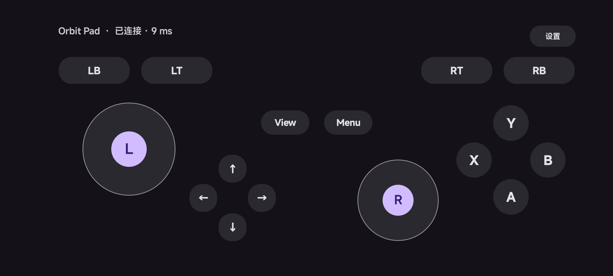

# Redmi K40 Pro+：Rust APK 0.4.0 真机验证

日期：2026-10-19（新加坡时间）。APK：Android 0.4.0 / versionCode 5。

设备为 Redmi K40 Pro+（M2012K11C），Android 16 / API 36，ARM64，系统页大小 4096 字节。已覆盖安装本地签名的 APK，安装、启动及 JNI 原生库加载正常。

## 结果

**62 个真机步骤全部通过**：基础套件 45 项，新增原生设置套件 17 项。未发现需要修改正式 APK 的失败项。

| 验证范围 | 结果 |
| --- | --- |
| 错误配对码、正确配对、自动横屏、常亮标志 | 通过 |
| ABXY、肩键、扳机、View / Menu、四向方向键分别按下与松开 | 通过 |
| 左摇杆死区、斜向输入 | 通过 |
| 双摇杆同时操作、三指双摇杆 + A，产生五个键 | 通过 |
| 逐指抬起、按钮独立释放、摇杆回中 | 通过 |
| 原生映射和手感设置页、系统返回保留连接 | 通过 |
| 按住 A 切后台，释放并断开；返回前台重连 | 通过 |
| 系统返回确认断开，回到连接页并释放 | 通过 |
| 竞速预设 B → R、RT → W；平台预设左摇杆 → 方向键 | 通过 |
| 原生选择框修改 A → Enter，并由电脑端核对 | 通过 |
| 死区设为 50%，小幅移动不输出、大幅移动输出 D | 通过 |
| 控件尺寸设为 80%，核对实际控件边界缩放 | 通过 |
| 关闭触觉反馈开关 | 通过，检查开关状态与保存；未测量物理振动 |
| Activity 重建并重新配对后，A → Enter、50% 死区、80% 尺寸及触觉开关保持 | 通过 |

手机与电脑通过实际局域网通信：电脑 `10.243.161.88:3215`，手机 Wi-Fi 接口为 `wlan1`，地址 `10.243.161.246/24`。USB / ADB 用于安装、注入测试事件和截图；ADB reverse 映射为空，没有用 USB 转发承载控制协议。

两套测试均使用不会发送 Windows 系统键盘输入的预览接收端。主机独立查询接收状态，核对每一步的按键、轴和连接状态。单指按钮使用 Android input 工具注入持续触摸；多指、设置与滑块使用 UiAutomation。设置测试结束后已恢复测试前的配置。测试时段未出现新的 crash buffer 记录。

## 证据

- `artifacts/redmi-rust-v0.4.0/report.json`：基础 45 项的期望、实际状态、设备与 APK 元数据。
- `artifacts/redmi-rust-v0.4.0/instrumentation.txt`：基础套件运行输出。
- `artifacts/redmi-rust-v0.4.0/three-finger-dual-stick-and-a.png`：实际三指输入时的手柄。
- `artifacts/redmi-rust-v0.4.0/material-settings-mapping.png`、`material-settings-feel.png`：原生设置页。
- `artifacts/redmi-rust-v0.4.0-settings/report.json`：原生设置 17 项的实际结果。
- `artifacts/redmi-rust-v0.4.0-settings/native-settings-saved.png`、`native-settings-restored.png`：设置修改和重建后的界面。

APK SHA-256：

```text
2d2acb0244caf52a5f5ecc959ac4d5b6731688dee53c9b93556a290715649071
```



## 范围

本次验证的是正式 ARM64 APK 经 Android 触摸系统、JNI / Rust 核心、实际 Wi-Fi 到接收端的完整链路。未验证具体游戏、反作弊、Windows 前台窗口的真实键盘事件、长时间续航或温升；设置持久化验证通过 Activity 重建完成，没有重启手机。16 KB 页支持已进行构建对齐检查，本机为 4 KB 页，不能作为 16 KB 页设备的运行证据。旧版 0.3.0 的测试记录保留在 `REDMI-TEST-REPORT.md`。
